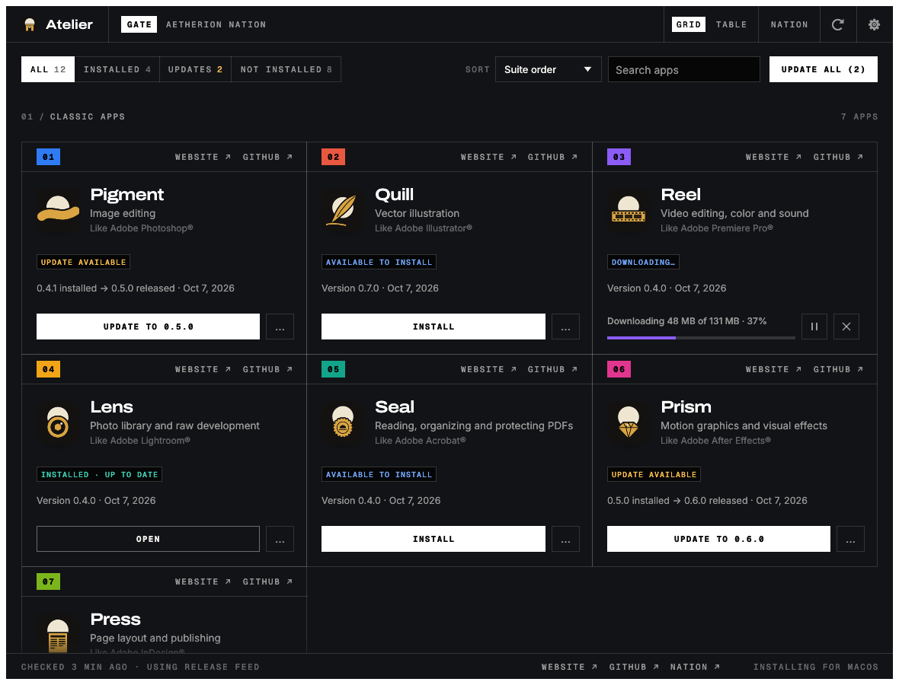
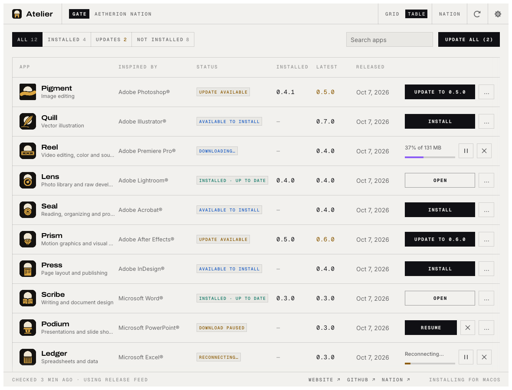

# Atelier Gate

**The way into Atelier.** Gate lists every Atelier app (Pigment, Quill, Reel, Lens, Seal, Prism,
Press, Scribe, Podium, Ledger, Blueprint and Frequency), shows which ones you have and which
version, installs the right build for your computer and keeps them up to date. A small native app
written in Rust that can sit in your menu bar or system tray. Runs on macOS, Windows, Linux and
FreeBSD, with a catalog-only version in the browser.

Gate is part of Atelier, Aetherion Nation's own creative suite. It is built on
[ArtCraft Launcher](https://github.com/storytold/craft-launcher) by the ArtCraft team (MIT OR
Apache-2.0), and keeps pulling their work in.

| What | Where |
|---|---|
| Run it | `cargo run --release -p artcraft-launcher` (desktop) · `apps/artcraft-launcher-web` (browser, with trunk) |
| Check it | `cargo xtask ci` (fmt, clippy, tests and the wasm check) |
| How it is built | `AGENTS.md`, `CLAUDE.md` |
| The brand layer, and what we change versus upstream | [`docs/brand.md`](docs/brand.md) |
| Pulling in upstream work | [`docs/upstream.md`](docs/upstream.md) |
| The Nation | [aetherionnnation.com/atelier](https://www.aetherionnnation.com/atelier) |

## Names and sources

The product is **Atelier Gate**. Crates, binaries, the `ai.storyteller.artcraft-launcher` app
id, release asset names, the Windows registry key and the `ARTCRAFT_LAUNCHER_*` environment
variables keep their upstream names on purpose, so that upstream changes merge cleanly; see
`docs/brand.md` before renaming anything.

Gate finds each app's releases in the Nation's own repositories
(`Aetherion-Nation-Builders/atelier-<app>`) and updates itself from `atelier-gate`. It does not
use ArtCraft's release feed. Until those repositories publish releases that Gate can read, it
shows each app without a version to install.

  

   
  Switch between the grid and a sortable table (screenshots from the test suite, with sample releases).

---

The sections below are ArtCraft Launcher's own notes, kept as upstream writes them (they still
say "ArtCraft Launcher" and "Craft apps"; in Atelier they are Gate and the Atelier apps).

## What it does

The Craft apps each ship their own builds for every platform. ArtCraft Launcher saves you from
hunting through a dozen release pages: it lists every app in the suite, shows which ones you have
and which version, installs the right build for your operating system and processor, and tells
you when an update is out. It is a small native app that can sit in your menu bar or system tray.

## Features

<table>
  <tr>
    <td width="33%" valign="top">
      <h3>📦 Install in one click</h3>
      Picks the right download for your OS and CPU (DMG, MSI, AppImage, .deb, .rpm and more), checks it against the release's SHA-256 checksums and installs it.
    </td>
    <td width="33%" valign="top">
      <h3>🔄 Stay up to date</h3>
      Checks each app's GitHub releases and updates the ones you have. A notification tells you when there's something new.
    </td>
    <td width="33%" valign="top">
      <h3>🧭 Always at hand</h3>
      Opens any Craft app from one window, or from the tray and menu-bar icon. Native egui, no Electron, no web view.
    </td>
  </tr>
</table>

The web version shows the same catalog in the browser, with the latest download for each app.

## Interface languages

The interface is in English, Russian (Русский) or Simplified Chinese (简体中文). **Auto**, the
default, follows the system or browser language; **Settings → Language** picks one and switches
at once, and the choice is kept between runs. Simplified Chinese locales (`zh-CN`, `zh-SG`,
`zh-Hans`, and POSIX forms such as `zh_CN.UTF-8`) select Chinese; Traditional Chinese ones don't.
To try a language without changing the setting, start the desktop app with
`ARTCRAFT_LAUNCHER_LOCALE=zh-CN`, or add `?lang=ru` to the web address.

Chinese is drawn with the system's own Chinese font (PingFang on macOS, Microsoft YaHei on
Windows, Noto Sans CJK or WenQuanYi on Linux and FreeBSD). Where there is none, and in the web
version, the interface stays in English and Settings says why. Product names and release notes
stay as published; text without a translation falls back to English.

## Where apps are installed

ArtCraft Launcher installs each app where your system normally keeps applications, using the
app's official release package, so an app installed by the launcher is the same as one you
installed by hand (and the launcher finds apps you installed yourself):

| System | Where | How |
|---|---|---|
| macOS | `/Applications/<App>.app` | Copied from the signed, notarized release DMG |
| Windows | `C:\Program Files\<App>` | The release MSI, through Windows Installer (with Start menu entry and Apps & features entry) |
| Linux | `/usr/bin`, `/usr/share/applications` | The release `.deb` (apt) or `.rpm` (dnf, zypper), with your system's password prompt. Without those, a Flatpak, or an AppImage in `~/Applications` |
| FreeBSD | `/usr/local` | The release tree, with a password prompt (polkit); `~/.local` when polkit isn't installed |

ArtCraft Launcher keeps itself current too: when a new version is out, **Update and restart**
downloads it, verifies it, puts it where this copy is installed (the `.app`, the Windows Installer
package or portable folder, the AppImage, or the `.deb`/`.rpm`) and reopens it.

Updates use the same format an app was installed with. Every download is checked against the
release's published SHA-256 before it is installed, and a running app is never replaced.

## License

MIT OR Apache-2.0, like ArtCraft Launcher. Third-party material is listed in `ATTRIBUTION.md` and
`NOTICE`. The Atelier and Aetherion names and marks are not covered by the license.

Adobe, Microsoft, Autodesk and Avid product names are trademarks of their owners, used only
to describe what each Atelier app is for. Atelier is independent and is not affiliated with,
sponsored by or endorsed by any of these companies.
